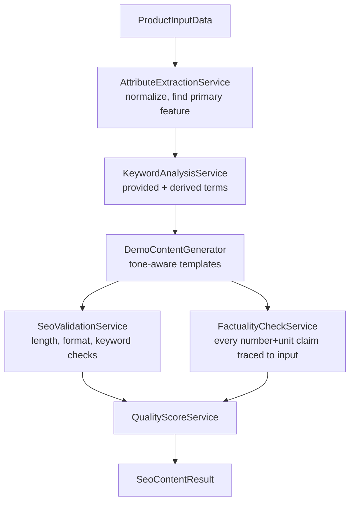

# Architecture

## Pipeline



### ASCII fallback

```
ProductInputData
      |
      v
AttributeExtractionService  (normalize, identify primary feature)
      |
      v
KeywordAnalysisService  (provided keywords + terms derived from name/category/features)
      |
      v
DemoContentGenerator  (tone-aware templates: title, meta, descriptions, bullets, FAQs, slug)
      |
      +---------------------+
      v                     v
SeoValidationService   FactualityCheckService
(length/format/keyword) (every number+unit claim traced to input data)
      |                     |
      +---------------------+
                v
        QualityScoreService
                |
                v
        SeoContentResult
```

## Components

| Component | Responsibility |
|---|---|
| `AttributeExtractionService` | Normalizes input, identifies the primary feature |
| `KeywordAnalysisService` | Combines provided keywords with terms derived from the product's own text |
| `DemoContentGenerator` | Deterministic, tone-aware template filling — no network, no API key |
| `SeoValidationService` | Length, format and keyword-presence rules — always deterministic |
| `FactualityCheckService` | Flags any number+unit claim not traceable to the supplied features/specs |
| `QualityScoreService` | Deterministic composite score from both validation stages |
| `SeoContentPipelineService` | Orchestrates all seven stages |

## Important Interfaces

- `FactualityCheckService.check()` takes both the generated content **and**
  the original `ExtractedAttributes` — it re-derives ground truth from the
  input every time, rather than trusting the generator's own claim that its
  output is grounded. This is what makes the check meaningful if a live
  LLM generator is ever swapped in for `DemoContentGenerator`: the safety
  net doesn't depend on which generator produced the text.
- `SeoValidationService` and `FactualityCheckService` are always
  deterministic Java, regardless of `ContentGenerator` implementation —
  the master brief for this collection requires this explicitly.

## External Dependencies

- Spring Web, Spring Validation (runtime)
- Spring Boot Test (JUnit 5, AssertJ — test scope only)
- No LLM dependency in this repository — `DemoContentGenerator` is the
  only generator shipped; see docs/design-decisions.md for why a live LLM
  option isn't included here the way it is in the Personal Research Agent
  project.

## Decision Points

- **Why no optional live-LLM generator, unlike the Personal Research
  Agent project**: see docs/design-decisions.md — the short version is
  that this pipeline's validation stages are designed to work
  identically regardless of generator, so adding one isn't necessary to
  demonstrate the architecture, and keeps this project's dependency
  footprint minimal.
